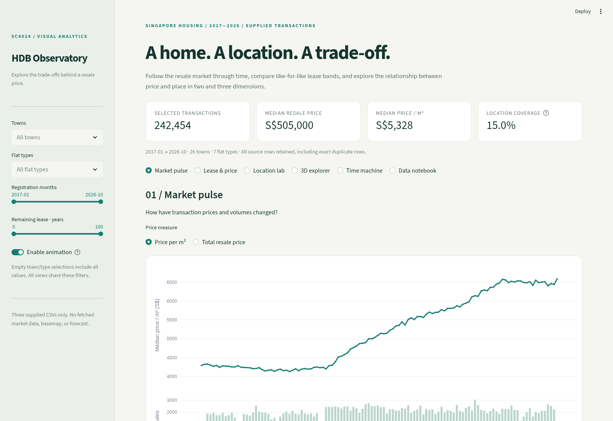
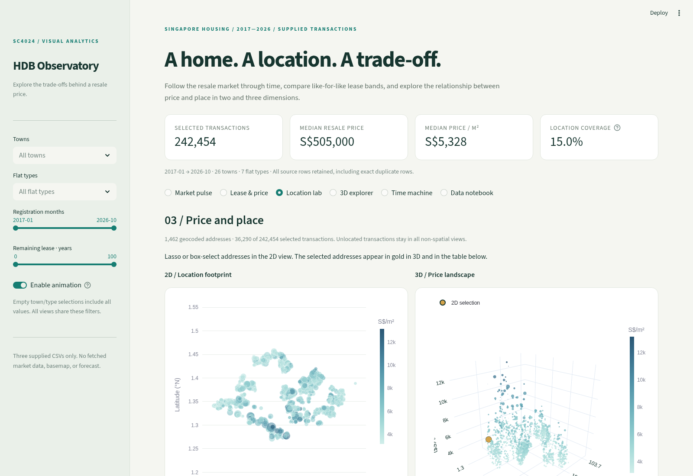

# HDB Observatory

An interactive Streamlit dashboard based on the `dashboard-wengshi` branch, rebuilt around the **three supplied CSVs only**. The application contains linked 2D/3D views, quarterly animation, shared filters and auditable exports. No interest-rate series, geocoding services, map tiles or price forecasts are used.

## Preview





These screenshots show the implemented dashboard. Download this branch using **Code → Download ZIP**, extract it, and follow the run commands below for the interactive version.

## Run

Python 3.12 is tested. From this repository:

```bash
python -m venv .venv
source .venv/bin/activate
python -m pip install -r requirements.txt
python -m streamlit run app.py
```

Windows: activate with `.venv\Scripts\Activate.ps1`. The server opens the dashboard in your browser. In the prepared cloud workspace, use `/workspace/.venvs/practice/bin/python -m streamlit run app.py --server.headless=true --server.port=8501 --browser.gatherUsageStats=false`.

Runtime needs no external network requests. Plotly, scripts and fonts are served locally, with system-font fallbacks. Internet access is required only to install dependencies. The uploaded notebook is not executed or used as a data source.

## Explore

| View | Question | Encoding / interaction |
| --- | --- | --- |
| Market pulse | How are prices, volume and sale mix changing? | Monthly median line with aligned volume bars; town median + interquartile interval; flat-type counts. Hover and zoom. |
| Lease & price | How does price vary with remaining lease within flat types? | Lease/type median heatmap with count suppression; five-year lease summaries separated by town; lease histogram. Shared filters. |
| Location lab | Where are price differences among known addresses? | Longitude/latitude footprint and linked 3D price landscape. Lasso/box selection highlights the same addresses in gold in 3D and filters the address table. MRT distance bands and town coverage audit. |
| 3D explorer | How do lease, area and supplied distances relate jointly to price? | Address-level 3D scatter, matching 2D projection, and parallel coordinates. Choose dimensions, rotate/zoom, inspect tooltips, brush parallel axes. |
| Time machine | How do town-level summaries move through lease–price space? | Animated quarterly bubbles: lease vs S$/m², optionally floor area as a third axis. Fixed ranges and stable town identities; 2D play/pause and a quarter slider in both views; minimum count and motion toggle. |
| Data notebook | What is behind each visual mark? | File hashes, join rules, coverage and duplicates; searchable transaction table and complete filtered CSV export. |

Towns, flat types, registration months and lease ranges filter every view. Empty town/type lists mean all values. Local parallel-coordinate brushing highlights lines in that chart only. Plotly toolbars support image export. Use **Enable animation** to disable playback and transitions for a static presentation; reduced-motion CSS also disables CSS transitions. For reduced motion, explicitly turn the toggle off; Plotly does not automatically inherit the OS preference.

## Accuracy and scope

- `resale_flat_prices.csv`: **242,454 rows**, 11 columns, January 2017–October 2026, **9,760 unique normalized addresses**. The extraction date is unknown and October 2026 / the final quarter may be incomplete.
- `hdb_coordinates.csv`: **9,760 address rows**, but only **1,462** have latitude/longitude.
- `hdb_spatial_features.csv`: **1,462 address rows** with supplied MRT, CBD, selected-school and Jurong-hub distances. The dashboard exposes MRT, CBD and selected-school fields; Jurong distance is retained in the joined data but not charted.
- Only **36,290 transactions (14.97%)** have these location features. Spatial analyses describe that subset, whose coverage varies by town. They cannot be generalized to every resale transaction.
- The coordinate and spatial files agree on overlapping coordinates. Normalized address joins are validated as many-to-one and retain the original resale row count.
- The **318 exact duplicate source rows remain** because no unique transaction identifier proves they are duplicate sales. A record ID is the original one-based row position, not a flat ID.
- Price/m² is computed for each transaction and then summarized. Remaining lease is parsed as years + months/12. No imputation, synthetic rows or arbitrary outlier trimming is applied.
- Town/lease/MRT comparisons are descriptive associations; differences in transaction mix remain. Price divided by remaining years is **not** an annual depreciation rate. The former fabricated SORA series and depreciation simulator are not used by this dashboard.
- 3D geographic height encodes price, not actual building height. Longitude/latitude are angular coordinates without a basemap or metre-distance interpretation.
- Address/town summaries describe different homes sold, not repeat sales of one home. The data do not support future valuation forecasts or causal conclusions about lease or location.
- Supplied distance derivation, station/school inventories and reference dates cannot be independently checked using these files alone. No external enrichment is requested.

## Course presentation ideas

A coherent narrative is more useful than displaying every chart at once:

1. Start with a question: **How do lease and location trade-offs accompany resale prices?** Use the market timeline to establish changing sale volume and mix.
2. Use the lease heatmap, restrict to one flat type and two or three towns, and inspect counts. Explain that a conditional comparison is stronger than pooling unlike homes.
3. Show the spatial coverage before making location claims. Select a cluster in 2D and show the same addresses highlighted in 3D.
4. Rotate the 3D trade-off plot to explore a third variable, then return to the 2D projection to assess the pattern precisely. Explain occlusion and perspective limits.
5. Play the quarterly town animation, pause at two quarters, and inspect counts. Explain that motion represents changing transaction summaries, not measured depreciation of the same flats.
6. Finish in the data audit: show the actual rows behind a visual, the join coverage, and the limits of the conclusions.

Animation is used for temporal progression; filters and linked selections support exploration. 2D views remain companions to 3D because height, depth and perspective can make exact comparisons harder. No grading outcome is promised; align the presentation with your course rubric.

## Validation

```bash
python -m unittest discover -s tests -v
```

Six tests validate row preservation, unlocated records, units, building medians, sparse-cell suppression, and animation identity/counts. All six views were also executed with Streamlit AppTest, including a town filter and empty-result selection. Browser checks exercise chart rendering, selection, 2D playback and the 3D quarter scene separately.

Implementation: `app.py`, `src/analytics_data.py`, `src/analytics_charts.py`, and `src/animated_view.py`. Legacy geocoding and original visualization modules remain for branch history/reference and are not imported or run by the dashboard.
